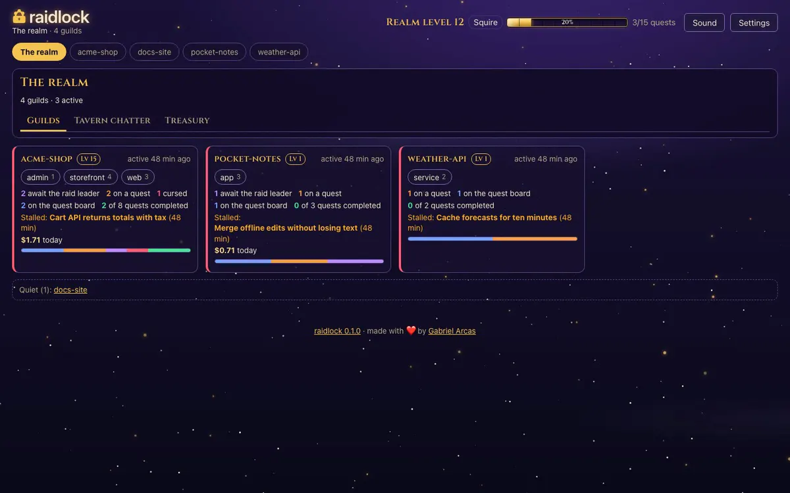

<p align="center">
  <picture>
    <source media="(prefers-color-scheme: dark)" srcset="docs/assets/brand/raidlock-lockup-dark.svg">
    
  </picture>
</p>

<p align="center"><b>raidlock stops parallel coding agents from overwriting each other's files, across Claude Code, Codex and Gemini, and won't accept their work until the tests pass and an agent from another provider signs off.</b></p>

<p align="center">
  <a href="https://github.com/agi1clj/raidlock/actions/workflows/ci.yml"></a>
  <a href="https://pypi.org/project/raidlock/"></a>
  <a href="https://pypi.org/project/raidlock/"></a>
  <a href="https://www.bestpractices.dev/projects/15999"></a>
  <a href="https://scorecard.dev/viewer/?uri=github.com/agi1clj/raidlock"></a>
  <a href="LICENSE"></a>
</p>

<p align="center"></p>

Run Claude Code, Codex, Gemini, shell scripts and people on one board. Each piece of work is a card. Claiming a card leases the exact paths it may touch, and hooks refuse edits anywhere else. One lead closes cards, and only after a signed verify receipt exists for the commit and, on a mixed-provider board, a reviewer from another provider has approved. You can follow who is doing what in the terminal or in a raid-themed web UI.

## Why

Parallel agents fail in predictable ways. Two of them edit the same file. One reports "tests pass" and nobody checks. The lead loses track of who is on what, and a stalled session keeps writing after someone else took over. raidlock is a small local tool that handles each of these:

- Path leases are atomic, keyed by the repo's git remote, and checked across every project on your machine.
- A fence number changes with every new owner, so a replaced worker's writes are refused.
- `raid done` is lead-only and refuses a card until its verify command has passed in a sandbox on the exact commit.
- Once a second provider joins, `done` also needs an approval from a reviewer on another provider.
- Board-first by default: the hooks deny edits outside a card you hold, including the lead's, and subagent launches whose prompt names no open card.
- It runs on your machine with no runtime dependencies. The Claude Code plugin adds about 190 tokens per session ([benchmark](docs/guides/benchmark.md)).

## Install with your agent

Paste this into Claude Code, Codex or another terminal coding agent:

```text
Install or update raidlock by following
https://raw.githubusercontent.com/agi1clj/raidlock/main/AGENT_INSTALL.md
```

The agent installs or upgrades to the latest release, adds the Claude Code plugin, runs `raid doctor`, creates a board and explains the board-first rule back to you. It never reads the lead secret.

## Install by hand

```bash
uv tool install raidlock          # or: pipx install raidlock
raid doctor
```

In Claude Code, add the plugin (hooks, skill and the `raid-worker` agent):

```text
/plugin marketplace add agi1clj/raidlock
/plugin install raidlock@raidlock
```

Needs Python 3.11 or newer on Linux or macOS. On Windows, use WSL2 (expected to work, not yet tested). Codex and MCP setup: [Install](docs/guides/install.md).

## Quickstart

Lead terminal:

```bash
mkdir -p ~/demo/shop && cd ~/demo/shop
raid quickstart --demo            # a board, a demo repo acme-shop/, and you as the lead
LEAD_SECRET_FILE="<the path it printed>"
raid --lead-secret "$LEAD_SECRET_FILE" new "Reject empty carts" --id checkout \
  --locks acme-shop/src/checkout --verify-cmd "python3 -m unittest"
```

Worker terminal:

```bash
cd ~/demo/shop/acme-shop
raid up --join --agent worker-1 --card checkout --runtime human   # then run the source line it prints
raid claim checkout --checkout "$PWD"                              # then paste the two export lines
raid ui --open                                                     # http://127.0.0.1:8765
```

worker-1 now holds `acme-shop/src/checkout`, and any other agent editing there is refused. [Getting started](docs/guides/getting-started.md) finishes the card: edit, commit, review, verify, done.

## How coordination works

One lead, many agents, one project. The lead splits work into cards with narrow, disjoint locks. Each worker claims one, posts notes and hands it back to review. The lead verifies and closes it:

```bash
raid --lead-secret "$LEAD_SECRET_FILE" new "Paginate orders" --id orders \
  --locks acme-shop/src/orders --verify-cmd "python3 -m unittest"
raid claim orders --checkout "$PWD"                                     # worker
raid note orders "pagination added; tests pass"                          # worker; renews the lease
raid --lead-secret "$LEAD_SECRET_FILE" msg --to worker-1 --card orders "keep page size at 50"
raid move orders review --note "python3 -m unittest: 9 passed"          # worker
raid --lead-secret "$LEAD_SECRET_FILE" verify orders                    # signed receipt on the commit
raid --lead-secret "$LEAD_SECRET_FILE" done orders
```

Many projects. Each workspace has its own `.board/`, and every board registers in one lease index under `~/.raidlock`. A path locked from one workspace is locked in all of them. `raid ui` shows every workspace on its realm page, with tabs for Guilds, Tavern chatter and Treasury.

Many sessions. Separate Claude Code or Codex sessions join the same board with `raid up --join`, each in its own clone or worktree. Leases map through the git remote, so every checkout of a repo shares one lock space.

Mixed providers. When an agent from a second provider joins, raidlock turns on the verify gate and the cross-provider review gate and records the change. Values you set yourself with `raid config set` are kept.

Board-first enforcement, on by default. The Claude Code hooks deny edits outside the card you hold, and that includes the lead: a lead edit inside a git repo needs a card the lead holds (`require_card_for_lead_edits`). A `Task` or `Agent` launch is denied unless its prompt names an open card as `card <id>` (`board_first_subagents`). Turn either off with `raid --lead-secret FILE config set <key> off`. The git commit guard checks other agents' leases either way.

Full version: [Orchestration](docs/guides/orchestration.md).

## Two ways to run agents

| | Workstreams | Sandboxed agents |
|---|---|---|
| What | Sessions you run yourself: Claude Code, Codex, you | `raid delegate CARD --to codex\|claude\|gemini\|shell` runs an agent CLI for you |
| Where | Your own clone or worktree; claim with `raid claim CARD --checkout "$PWD"` | A throwaway clone with no remote and a cleared environment |
| Guard | Lease, edit hooks, git guards | Lease, a diff check against the card's locks and a secret scan; the lead applies the returned patch |
| Cleanup | Yours | The clone is deleted on `done`, `close` or `cancel`; logs and the patch stay |

Use a workstream for a session you watch, and `raid delegate` for unattended or less trusted runs. Details: [Workstreams and sandboxed agents](docs/guides/orchestration.md#workstreams-and-sandboxed-agents).

## Features

| Feature | Guide |
|---|---|
| Path leases with expiry and fencing, across clones, worktrees and workspaces | [Concepts](docs/guides/concepts.md) |
| Board-first hooks, git pre-commit and pre-push guards, runner diff | [Hooks](docs/guides/hooks.md) |
| Lead-only done, signed verify receipts, cross-provider review | [Verification](docs/guides/verification.md) |
| `raid delegate`, `raid next` routing on plan headroom, `raid duel`, `raid resume`, opt-in `raid resurrect` | [Orchestration](docs/guides/orchestration.md) |
| Import a checklist or a spec tool's `tasks.md`, lock suggestions, merge-conflict foresight, a lessons vault | [Planning](docs/guides/planning.md) |
| Pull requests from a verified commit; merged PRs close cards through the gates | [Pull requests](docs/guides/pr.md) |
| Spend per card, model, agent and day; delegation budgets | [Operations](docs/guides/operations.md#delegation-budgets) |
| Live web UI on `127.0.0.1`: Needs you first, quest log, chatter, cost, dependency graph, lease map, replay | [Web UI](docs/guides/ui.md) |
| CLI with `--json` and stable exit codes; an MCP server that never acts as lead | [Commands](docs/guides/commands.md), [MCP](docs/guides/mcp.md) |
| Optional hardened container image for `raid ui`, `raid mcp` and sandboxed verify | [Docker](docs/guides/docker.md) |

Gemini runs only through `raid delegate --to gemini`, and that adapter is tested against recorded events, not a live Gemini CLI.

## Documentation

- Start: [Install](docs/guides/install.md), [Getting started](docs/guides/getting-started.md), [Concepts](docs/guides/concepts.md)
- Run a board: [Lead playbook](docs/guides/lead-playbook.md), [Worker rules](docs/guides/worker-rules.md), [Claude Code plus Codex](docs/guides/multi-provider.md), [Orchestration](docs/guides/orchestration.md)
- Reference: [Commands](docs/guides/commands.md), [Protocol](PROTOCOL.md), [Hooks](docs/guides/hooks.md), [Verification](docs/guides/verification.md), [Web UI](docs/guides/ui.md), [MCP server](docs/guides/mcp.md)
- More: [Planning](docs/guides/planning.md), [Operations](docs/guides/operations.md), [Agent Teams and Codex hooks](docs/guides/native.md), [Docker image](docs/guides/docker.md), [Overview, FAQ and alternatives](docs/guides/overview.md), [Examples](examples/README.md)

If you are an agent, start with [skills/raidlock/SKILL.md](skills/raidlock/SKILL.md).

## Why "raid"

Running several agents feels like leading a raid in an MMO such as World of Warcraft: a raid leader assigns the party, each member holds a role, big quests become bosses, and nobody loots until the boss is down. raidlock borrows that vocabulary for the web UI (guilds, quests, raid frames, boss board, feats). The CLI and the docs use plain terms. raidlock is not affiliated with or endorsed by Blizzard Entertainment.

## Security

raidlock keeps cooperating agents out of each other's way. It is not a sandbox. Tokens, the lead secret and the verify signing key are files under your user account, readable by any process running as you. `raid verify` runs only under bubblewrap on Linux or `sandbox-exec` on macOS. The UI listens on `127.0.0.1` and answers `GET` only. Threat model and reporting: [SECURITY.md](SECURITY.md). Limits: [Security and limits](docs/guides/overview.md#security-and-limits).

## Contributing

See [CONTRIBUTING.md](CONTRIBUTING.md) and the [Code of Conduct](CODE_OF_CONDUCT.md).

## License

[MIT](LICENSE). The web UI bundles the Cinzel font under the [SIL Open Font License 1.1](src/raidlock/web/static/fonts/OFL.txt). raidlock is an independent project, not affiliated with or endorsed by Anthropic, OpenAI or Google. Claude, Codex and Gemini are trademarks of their respective owners.
