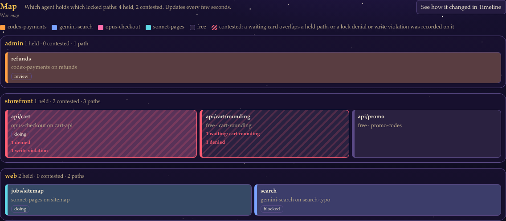
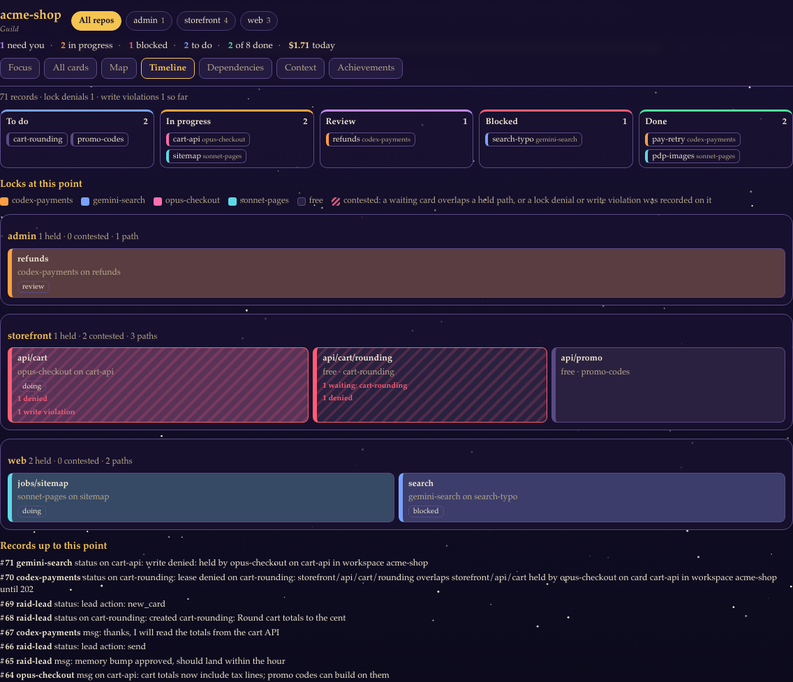
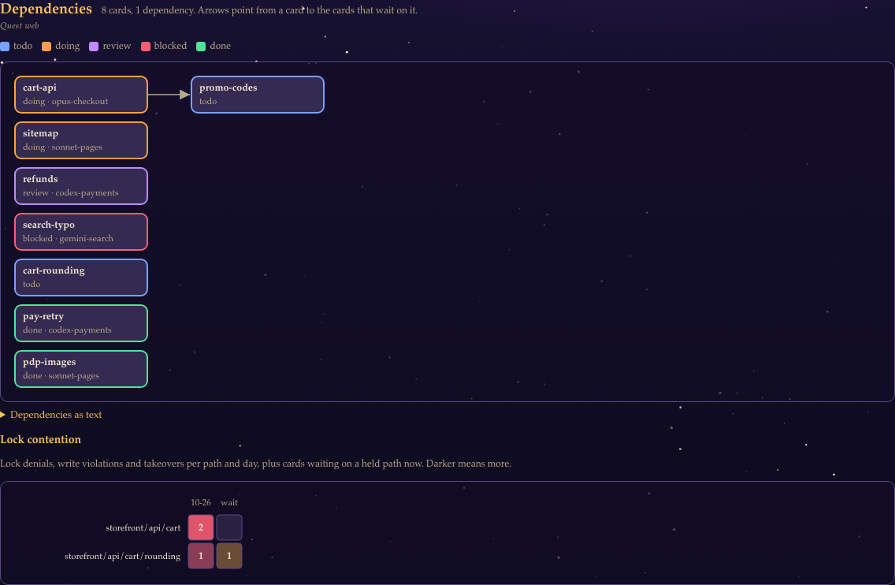
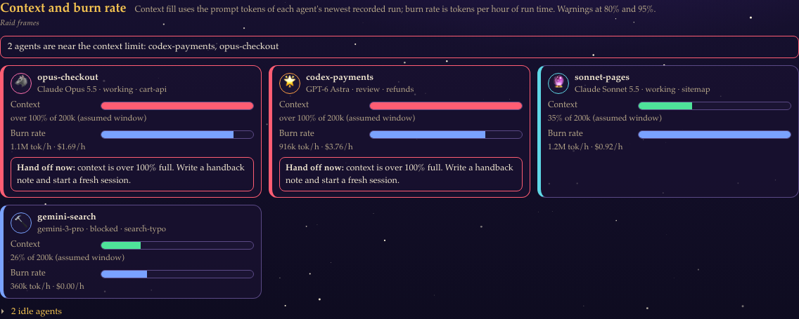
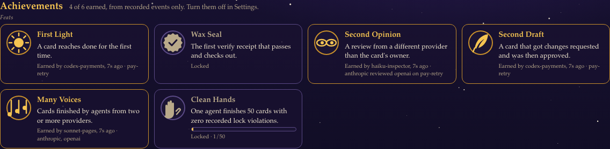

# Web UI and watchers

Four ways to watch a raid: the web UI, a terminal board, desktop notifications and an HTML snapshot. All of them only read the board.

## Web UI

```bash
raid ui --open
```

`raid ui` serves every workspace registered on this machine at `http://127.0.0.1:8765`. `--port` picks another port, and `--only` (or `--board PATH`) serves one board. The server listens on localhost only (`--host 0.0.0.0` is allowed only inside the [container image](docker.md#web-ui), published on the host's loopback), checks the `Host` header, serves a fixed file list and answers `GET` only. The page polls every 3 seconds. Nothing on the page changes the board: every action button copies a command for you to paste in the lead terminal.

Routes:

- `/` is the realm page, with three tabs. **Guilds** (subtitle: Workspaces) lists every workspace, busiest first (blocked or stalled, then review, then in progress); quiet workspaces are one line under them. **Tavern chatter** (subtitle: Chatter) shows recent notes and messages from every workspace. **Treasury** (subtitle: Cost) shows spend, the forecast and budget alerts across workspaces.
- `/<workspace>` opens one board on its **Focus** view.

### Focus view

The workspace header has two rows: the **Zones** buttons, which filter every view by repo, and the view tabs, ordered by how often a lead needs them: War room (this view), Quest log, Tavern chatter (the chat full width, with its unread count), Quest web, War map, Raid frames, Treasury (spend, forecast and results by model), Chronicle, Boss board and Feats. The guild level sits at the top right. A search box on the right filters cards and chat by title, card id, agent, ticket or repo as you type, with a match count; press `/` to jump to it and Esc to clear it. Press `?` for the list of keyboard shortcuts.

The default page answers one question: what needs the lead now. From top to bottom:

| Section | What is in it | What you do |
|---|---|---|
| **Needs you** | Cards in review that pass the done gate (verification and the board's required approvals), blocked cards, reviews awaiting the lead, lead questions from chatter, done cards whose runner patch is not applied yet and duels waiting for a winner. The header counts each kind; the first 5 items show, **Show all N** expands the rest. Lessons waiting for approval sit in the separate Lore inbox. | One primary button per item: **Close card** copies `raid --lead-secret <secret> done <card>`, **Approve** copies the lesson approval, **Apply patch** and **Decide** copy their command. **Details** shows the notes, locks, reviews and the command itself. |
| **Decisions** (collapsed) | Blocked cards whose last note asks the lead for something: it names the lead, asks a question, or asks to approve, confirm, pick or decide. One line each: title and reason. | **More** holds `raid show`, `resume`, `resurrect --dry-run` and `claim --take-over`. |
| **Blocked** | Not in Needs you: blocked cards waiting on something outside the board are counted in one line under Needs you, with a link to the Blocked lane. | Open them in All cards. |
| **Review** (collapsed) | Cards in review that do not pass the done gate yet, with the approval count. | **More** holds the verify and review commands. |
| **In progress** | Every card in progress with its owner and when its lease ends. **Can be taken over from &lt;agent&gt;** appears only when that worker's lease has expired, so another worker can run `raid claim <card> --take-over`. It never appears on the lead's own card or on blocked cards. | **Details** |
| **To do** | The first 10 cards, claimable first, with **Ready** or the first reason a card cannot be claimed yet. **Show all** lists the rest. | **Details** |

Beside them, the sidebar holds **Chatter** and **Agents**. Below the board, full width and collapsed: **Done**, **Cost**, **Score** and **Activity** (the board transcript, filterable by card). Each opens with one click and remembers its state in this browser.

Commands use the real lead secret path when it lives under your home folder (shown as `~/...`), or `keychain` when the lead secret is in the keychain. When the secret file lives elsewhere, commands use `"$LEAD_SECRET_FILE"`, the same shell variable the [getting started](getting-started.md) guide sets in the lead terminal to the path `raid quickstart` prints (set it, do not export it).

**All cards** shows the five lanes (To do, In progress, Review, Blocked, Done) side by side, 40 cards per lane with **Show more**. The repo buttons next to the workspace name filter both views by repo.

### Agents

The **Agents** panel lists active agents first: agents that hold a card or a lease, or were seen in the last 2 hours. They are sorted blocked and stalled first, then working, then waiting for review. Every other agent is behind **N not seen for 2 hours**. An agent card shows its model and runtime, billing mode and trust score only when they were reported or measured: no "unknown" placeholders, and no trust score until there is verification or review evidence.

### Usage strip

The strip under the header shows, per provider with real data, the context use of its newest session, its 5-hour and weekly plan windows with their reset times, Claude Code's own session cost estimate, and when the data was last updated. Providers with no data are not drawn; **Settings** lists them with the reason. Where the numbers come from and how they stay fresh: [Limits](limits.md).

### Empty, loading and error states

Every empty section says what to run next: no cards (`raid --lead-secret ... new`), nobody working (`raid claim <card>`), no workers (`raid up --join`), no boards (`raid quickstart`). A view that is still loading says so. When the server stops answering, the header says `Start it again with: raid ui`, and the page reconnects on its own once it is back.

### First quest

When the browser first opens a workspace that has no cards, the War room shows a small **First quest** panel with four steps and a copy button for each command: create a card (`raid --lead-secret FILE new "<title>" --locks <repo>/<path> --verify-cmd "<check>"`), claim it (`raid claim <card>`), verify it, and close it with `done`. Each step ticks off from the live board: a card exists, a card is claimed, a verify receipt or a card in review, a card done. Once the first card is done the panel goes away. The close button hides it for that workspace in this browser. On the overview, the panel shows while every workspace is empty.

### Ambient motion

The page stays alive: golden motes drift on the breeze over a denser star field, mist bands roll by, embers drift up the background, the logo glows like a torch, quests in progress breathe, avatars bob, primary buttons shimmer, Needs you glows, section icons sway, the XP bar shines, cards lift on hover and views fade in when you switch tabs. When a boss is slain, a victory screen names it, the quest count and who landed the final blow, with a fanfare; Esc or Onward closes it. The header shows the guild's daily streak (days in a row with a finished quest). It is CSS only, and it stops with **Settings > Animations: off** or the system's reduce-motion setting.

### Accessibility and layout

The UI follows WCAG 2.2 AA: text and controls meet contrast on the dark raid palette, targets are at least 24 px, every control works from the keyboard with a visible focus ring, meters and live regions carry screen-reader labels, and animations stop under reduced motion or the animation setting. Layouts are checked at 390, 768, 1024, 1280 and 1440 px with no horizontal page scroll. Sections fold one level deep, text lines stay under about 75 characters, and the browser suite tests these rules.

### Views

The ten view tabs in the workspace header are War room (Focus), Quest log (All cards), Tavern chatter, Quest web, War map, Raid frames, Treasury, Chronicle, Boss board and Feats. Five of them are the read-only views below. Each has its own address, `/<workspace>?view=<name>`, so the back button and bookmarks work, and a matching command with `--json` output. A view is drawn only while it is open.

| View | `?view=` | Command | API |
|---|---|---|---|
| Map | `map` | `raid map` | `/api/raidmap/<workspace>` |
| Timeline | `replay` | `raid replay` | `/api/replay/<workspace>` |
| Dependencies | `graph` | `raid graph` | `/api/graph/<workspace>` |
| Context | `frames` | `raid frames` | `/api/frames/<workspace>` |
| Achievements | `achievements` | `raid achievements` | `/api/achievements/<workspace>` |

#### Map



Every locked path on an open card, grouped by repo. A tile is colored by the agent whose live lease covers it; a free path is gray. A tile is marked contested, with red hatching, when a todo or blocked card overlaps a path someone else holds, or when the transcript records a lock denial or a write violation on it. The tile says which: `1 waiting: cart-rounding`, `1 denied`, `1 write violation`. The map follows live leases, so an expired doing lease shows as free. **See how it changed in Timeline** opens the timeline, which draws the same map at any past point.

```bash
raid map
raid map --at 120
```

#### Timeline



A slider over the transcript. Drag it, use the arrow, Home and End keys, or **Previous**, **Next** and **Play**, and the view rebuilds the lanes, owners and lock map as they were right after that record. It folds the recorded events in order: card created, claimed, moved, released, reopened and reaped, plus spend and notes. Cards with no creation record in the transcript show up once they are first mentioned. The slider holds the newest 4,000 records; the state always folds every record. **Latest** reloads it with new records.

```bash
raid replay --at 120 --json
```

#### Dependencies



The card dependency graph, drawn as inline SVG with no external library: earlier work on the left, arrows from a card to the cards that wait on it, borders colored by lane. Dependency cycles and missing cards are listed under **Dependencies as text**. Below it, a lock-contention heatmap: one row per contended path, one column per day with lock denials, write violations and takeovers, and a last column for cards waiting on that path now. Wide graphs scroll inside their own box.

#### Context and burn rate



One frame per active agent with two bars; idle agents are behind **N idle agents**. Context is the prompt side of the agent's newest recorded run (input, cache reads and cache writes) over the model's context window. A run that spans several turns reports summed usage, so treat it as an upper bound. An agent with no recorded run gets an estimate from the transcript records it sent or received since its claim plus its card brief, at about 4 characters per token, labeled `estimate`.

The window comes from `context_window` on the model's entry in `$RAIDLOCK_HOME/pricing.json`:

```json
"claude-sonnet-5-5": {"provider": "anthropic", "input": 2.0, "output": 10.0, "context_window": 1000000}
```

Without it raidlock assumes 200,000 tokens and labels the bar `assumed window`. Burn rate is tokens and API-equivalent dollars per hour of recorded run time over the newest five runs, scaled against the fastest agent on the board. At 80% context a working agent gets **Hand off soon**, at 95% **Hand off now**: write a handback note and start a fresh session.

```bash
raid frames
```

Each frame also carries a party role, worked out from the board on every read and never stored:

| Role | Score |
|---|---|
| Tank | leases held now on blocked cards, plus claimed cards that were blocked or that other cards depend on |
| Healer | reviews and passing verify runs on other agents' cards, plus moving someone else's card out of blocked |
| DPS | finished cards the agent owns, plus leases held now on cards that are not blocked |

The highest score wins; ties go to DPS, then Tank, then Healer. An agent with no activity gets no badge, and cancelled cards never count.

#### Boss board

The **Boss board** tab shows Everything is worked out from the cards on every read and nothing is stored.

A card that three or more other cards depend on, directly or through other cards, is a boss. The lead can also mark a large quest as a boss with `raid --lead-secret "$LEAD_SECRET_FILE" edit CARD --boss on` (`--boss off` clears it). Its HP bar is the share of the boss and those dependents still open, so it falls as they close; when all of them are done the boss shows as slain with the time of the last close. Cancelled cards are left out, and dependency cycles are counted once. There is no size field on cards, so a card cannot be marked large by hand.

Below the bosses, each agent has a loot bag with one item for every done card it owns. The rarity (Common, Uncommon, Rare, Epic, Legendary) comes from the card's dependents (up to 4 points), changes-requested reviews (up to 2), a first verify run that passed (1) and recorded run time (1 from one hour, 2 from four hours); every two points move up one rarity. The item name comes from a hash of the card id, so the same card always drops the same item. Names are original to raidlock. The 12 bags with the rarest drops show first; **Show all N bags** opens the rest.


#### Achievements



On by default. Turn them off with **Settings > Achievements: off**; the choice is stored in this browser only, and while it is off the page never asks the server for them. They are earned from recorded events only and grant nothing:

| Name | Earned when |
|---|---|
| First Light | a card reaches done for the first time |
| Wax Seal | a verify receipt passes and its signature checks out |
| Second Opinion | a reviewer from a different provider than the card's owner records a verdict |
| Second Draft | a card gets changes requested and is then approved |
| Many Voices | cards are finished by agents from two or more providers |
| Clean Hands | one agent finishes 50 cards with no recorded lock violation |

Names and art are original to raidlock. `raid achievements` prints the same list.

### Settings

The UI has one theme, raid, and no theme switch. The page uses the raid look (dark, serif, stars, animations) and game wording: section titles lead with the raid name and keep the plain name as a subtitle (Quest board / To do, On a quest / In progress, Hall of legends / Done, Tavern chatter / Chatter, Treasury / Cost), views become War room, Quest log, War map, Chronicle, Quest web and Raid frames, repos are zones and the overview is the realm. Primary buttons read Turn in quest, Hold council, Lift the curse and Inspect loot. Each workspace shows its **Guild level** and the overview its **Realm level**: level 1 to 60 from closed cards against open ones (cancelled cards do not count), ranked Recruit, Squire, Knight, Champion, Hero, Legend and Mythic, with a quest progress bar. Gaining a level plays a level-up chime and animation (off with reduced motion or the animation setting). Copied commands always use plain terms.

The **Settings** menu holds the switches below and the list of providers the usage strip leaves out. Each choice is stored in this browser's local storage, never on the board:

| Switch | Effect |
|---|---|
| Animations | The moving background, glows and level-up effects. On by default; the system's reduce-motion setting also stops them. |
| Desktop alerts | Browser notifications for new events while the tab is in the background. The browser asks for permission the first time. Off by default. |
| Achievements | Show the [achievements](#achievements) view. On by default. |

### Sounds

Sound is on by default. Browsers block audio until you interact with the page, so a banner asks for one click first. The **Sound** menu has a mute switch, a volume slider and one checkbox per cue:

| Cue | Plays when |
|---|---|
| Message sent | a message is delivered right away |
| Message queued | a message waits until the recipient is free |
| Message delivered | a queued message is released |
| Message read | the recipient opened it |
| Note | an agent adds a note |
| Claim | a card moves to in progress |
| Review | a card is handed in for review |
| Blocked | a card is blocked |
| Done | a card is finished |
| Stalled | an agent goes quiet too long |
| Lease expiring | a held lease has under 5 minutes left |
| Lease expired | a held lease ran out |
| New card | a card is added or reopened |
| Spend | new tokens are recorded on a card |

All sounds are synthesized in the browser; no audio files ship with raidlock.

### Spend forecast and budget alerts

The **Cost** panel shows paid USD and, for plan usage, what the same tokens would cost at API prices, then a forecast: the trailing seven-day daily burn rate, the forecast to the end of the calendar month (UTC), and a bar per day for the last 14 days with the first day, the peak and the last day under it. Spend is counted the way [delegation budgets](operations.md#delegation-budgets) count it: paid USD plus the API-equivalent of plan usage, unless `budget.count_plan_usage` is false. With caps set, alerts appear at 80% of the daily or monthly cap, when a cap is reached, and when the forecast passes the monthly cap. On the overview the forecast and alerts cover every workspace, and each alert names its workspace.

```bash
raid budget set budget.workspace.monthly_usd 50
raid treasury
raid treasury --all
```

### Reputation (experimental)

The **Score** panel (its own fold, next to Team) and `raid reputation` show a trust score per agent, model or provider, once there is evidence:

```bash
raid reputation --by model
```

The score starts at 50. The verify pass rate moves it by up to 30 points either way and the review approval rate by up to 20; each rework costs 5, each lock violation or denial 10 and each stall 5. The result is clamped to 0 to 100. Every input is shown next to the score. The score is experimental: the weights may change, missing evidence is not proof of good behavior, and it grants no permissions and routes no work.

### Export snapshot

**Export snapshot** on a board downloads the same HTML file as `raid snapshot`.

## Notifications

The bell in the header lists what needs the lead: cards ready to close, patches to apply, duels to judge, reviews, blocked quests and agents that went quiet. On the realm page it covers every guild and tags each item with its guild; on a guild page it covers that guild only. The count shows items you have not seen yet and clears when you open the bell; the bell rings when a new item arrives. With **Desktop alerts** on in Settings, each new item also raises a browser notification while the tab is in the background.

When a newer raidlock release exists, an **Update** button appears next to the bell with the upgrade commands to copy.

## Terminal board

```bash
raid watch
raid watch --workspace weather-api --interval 5
```

A live board in the terminal, redrawn every 3 seconds by default. Press `q` or Ctrl+C to quit. `--json` is not supported. Native Windows terminals are unverified.

## Desktop notifications

```bash
raid notify
raid notify --once
```

Polls the board every 2 seconds and sends a desktop notification when a card enters review, a lease has under 5 minutes left, an agent stalls, or someone messages the lead. Each event is sent once, with a 60-second debounce. It uses `terminal-notifier` or `osascript` on macOS and `notify-send` on Linux. `--once` checks the current state once and exits.

## HTML snapshot

```bash
raid snapshot --out board.html
raid snapshot --out board.html --redact
```

Writes a self-contained HTML page with the lanes, cards, owners and agents. `--redact` drops notes and replaces paths and email addresses with `[redacted]`; review the file before you share it anyway. The output path must be inside the workspace, or under `exports/` inside `RAIDLOCK_HOME`; writing anywhere else needs the lead secret. A worker also needs a live lease covering the output path. A snapshot never overwrites `.board/`, `.git/` or agent credentials.
